<div align="center">
  <h1>
    <picture>
      <source media="(prefers-color-scheme: dark)" srcset="docs/brand/contrack-lockup-animated-dark.svg" />
      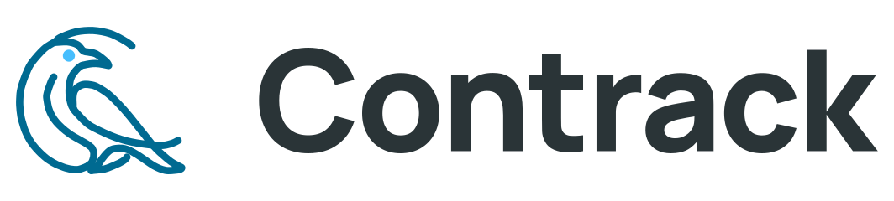
    </picture>
  </h1>
  <p><b>Privacy focused people management and search</b></p>

[](https://github.com/arvarik/contrack/actions/workflows/ci.yml)
[](https://github.com/arvarik/contrack/releases)
[](https://github.com/arvarik/contrack/pkgs/container/contrack)
[](https://nodejs.org/)
[](LICENSE)
[](https://scorecard.dev/viewer/?uri=github.com/arvarik/contrack)

</div>

<br/>

<p align="center">
  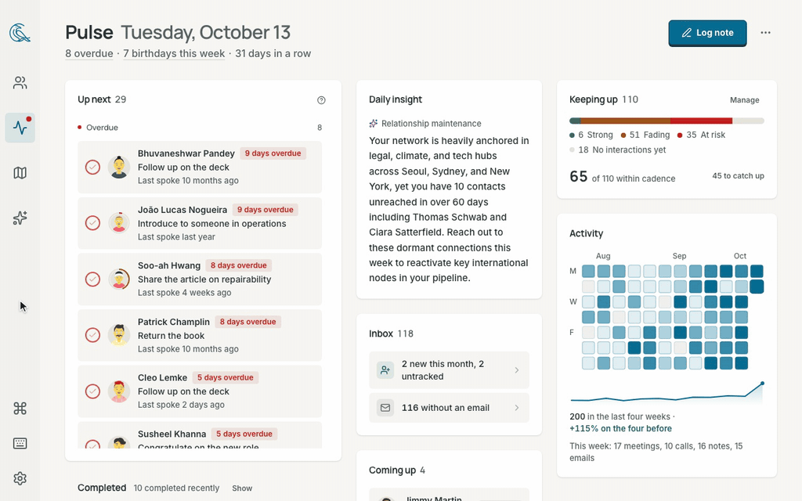
</p>

Contacts are scattered all over your apps, often have a large overlap, and aren't necessarily filled in with the most amount of information you'd like. When every app requests access to your contacts, it doesn't really feel like you *own* your network. 

And even when you meticulously update your private Apple contacts, there's no good way to keep building the relationship or continuously updating their important details.

Contrack solves all of these by being an all-in-one, self-hosted contact management app that a follows a simple 4 step process:

## Import → Dedupe → Enrich → Track

<table>
<tr>
<td rowspan="4" width="19%" align="center" valign="middle">
  <picture>
    <source media="(prefers-color-scheme: dark)" srcset="docs/brand/readme-flow-dark.svg" />
    
  </picture>
</td>
<td width="81%" valign="middle">
  <h3>1. Import</h3>
  <p><b>Everyone, from everywhere.</b> Drop in your contacts from Apple, Google, or LinkedIn. Connect your calendar or inbox, and past conversations and meetings appear right on each person's timeline.</p>
  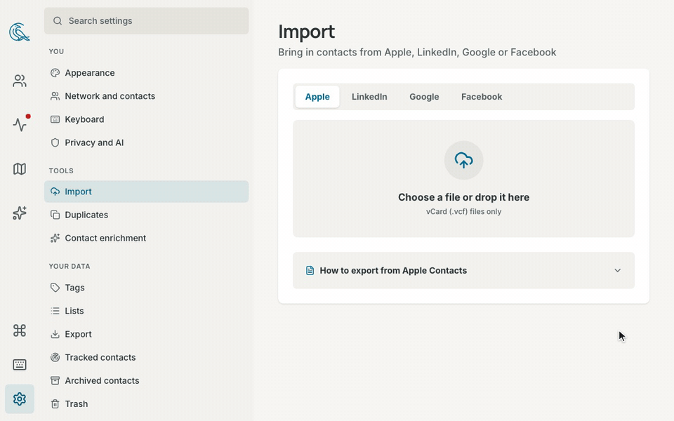
</td>
</tr>
<tr>
<td width="81%" valign="middle">
  <h3>2. Dedupe</h3>
  <p><b>One person. One clean story.</b> The same friend from three address books becomes a single profile. Contrack merges the obvious matches automatically and lets you review the rest side by side, with a 90-day undo if you ever change your mind.</p>
  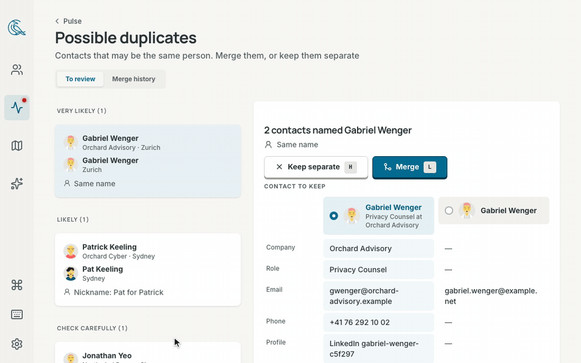
</td>
</tr>
<tr>
<td width="81%" valign="middle">
  <h3>3. Enrich</h3>
  <p><b>All the context you never had time to type.</b> Paste a quick note like <i>"Met at Sarah's wedding, loves natural wine, kids are Leo and Maya, catch up every quarter"</i> or <i>"Partner at Sequoia, follow up next Tuesday on seed round"</i>, and Contrack turns it into a complete profile with dates, tags, and reminders. Or let web research fill in roles and links with cited sources.</p>
  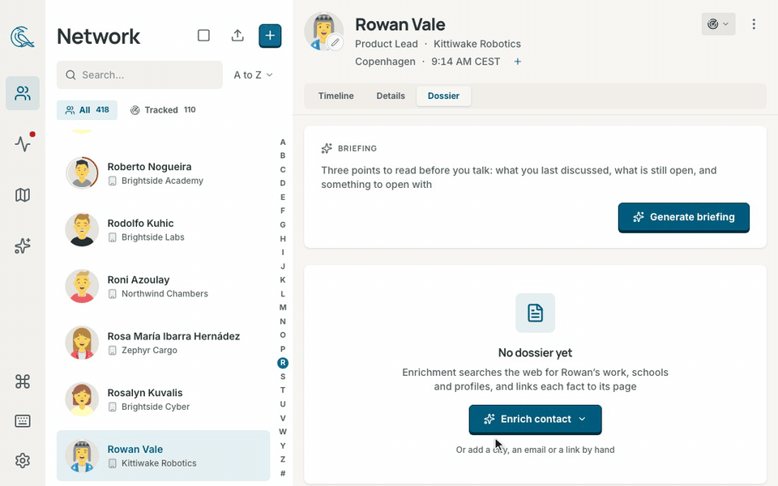
</td>
</tr>
<tr>
<td width="81%" valign="middle">
  <h3>4. Track</h3>
  <p><b>Never let someone important drift away.</b> Write a note in plain language and <i>"next Tuesday"</i> becomes a reminder automatically. Set how often you want to stay in touch, and each morning Contrack gently shows who is due and whose birthday or milestone is coming up.</p>
  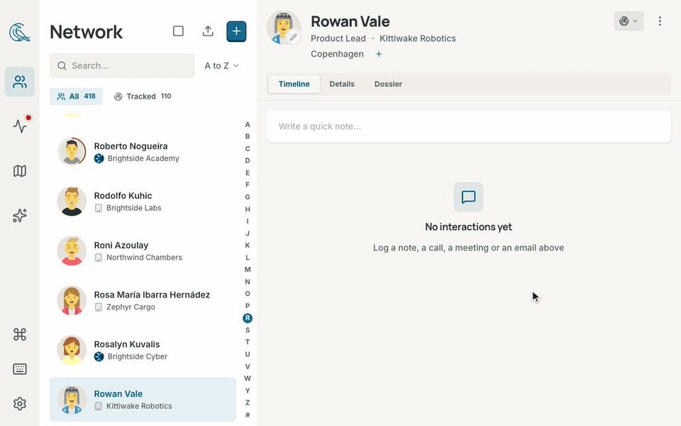
</td>
</tr>
</table>

## Highlights

<table>
<tr>
<td width="50%" valign="top">
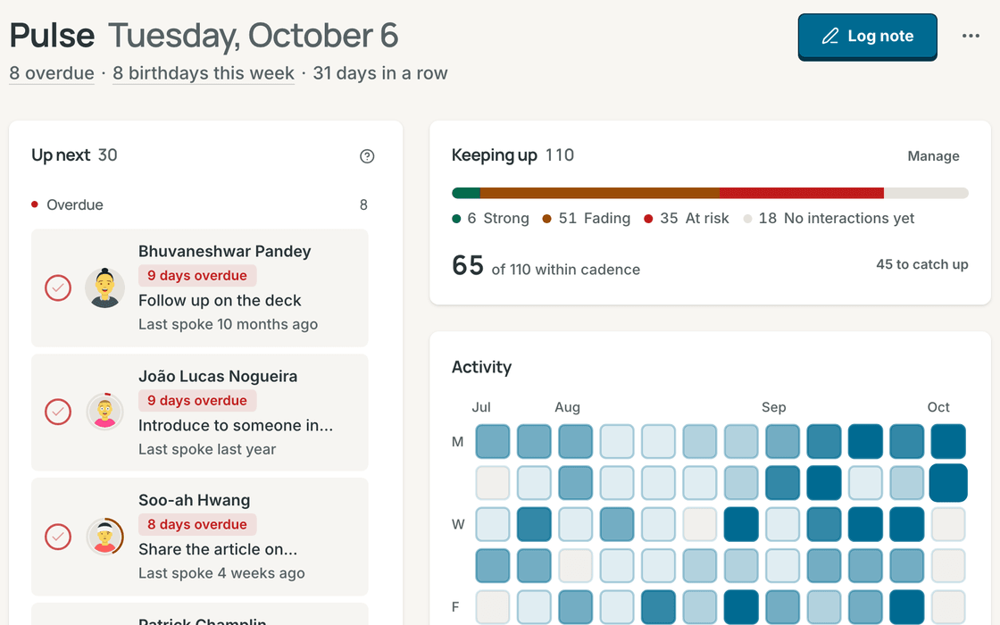
<h3>Pulse</h3>
Your calm morning briefing. See the follow-ups due today, friends and colleagues you haven't spoken with in a while, and upcoming birthdays, anniversaries, and custom milestones.
</td>
<td width="50%" valign="top">
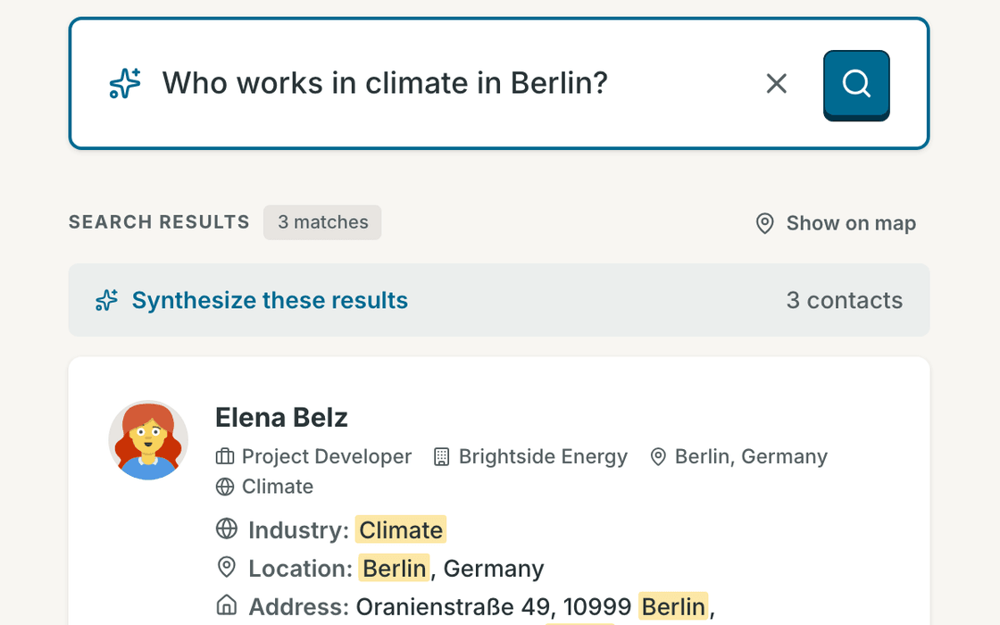
<h3>Ask Contrack</h3>
Ask in plain words, like <i>"Who do I know in Lisbon?"</i> or <i>"Who loves natural wine?"</i> Answers come straight from your own contacts and notes, searched privately on your machine.
</td>
</tr>
</table>

<table>
<tr>
<td width="50%" valign="top">
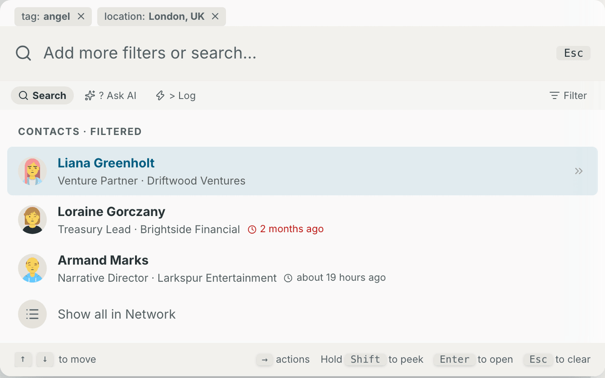
<h3>Command palette</h3>
Press <kbd>Cmd</kbd>+<kbd>K</kbd> to jump to anyone, filter by company or tag, or log a quick note without ever lifting your hands from the keyboard.
</td>
<td width="50%" valign="top">
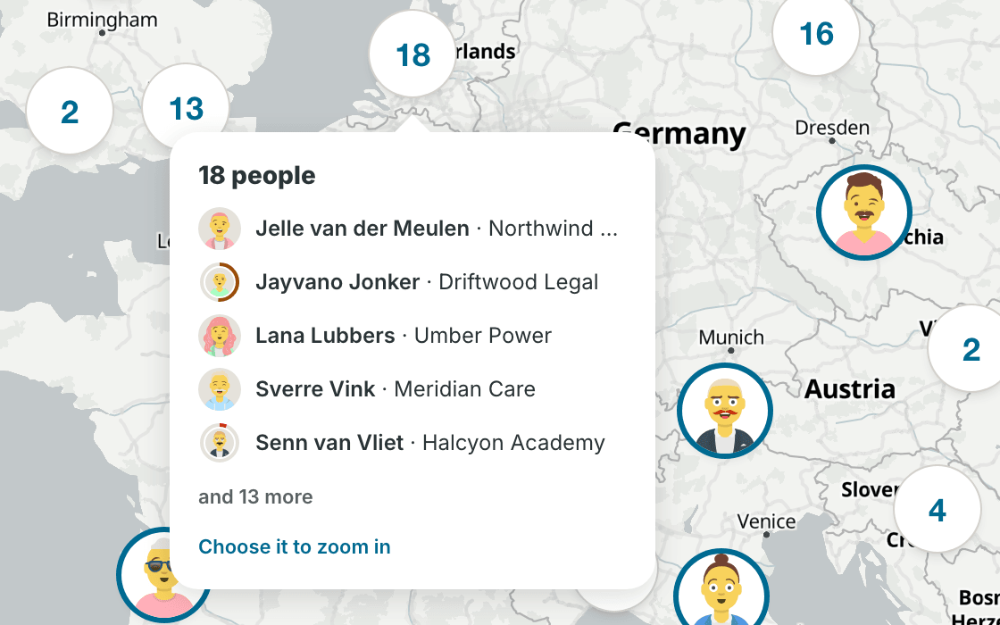
<h3>Map</h3>
Planning a trip? See everyone you know in a city at a glance. Draw a loop around a neighborhood to select everyone there and add them to a dinner list.
</td>
</tr>
</table>

<table>
<tr>
<td width="50%" valign="top">
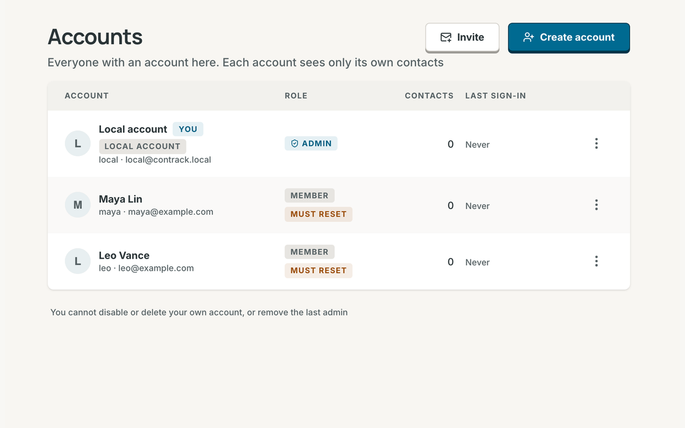
<h3>Multiple profiles, one home</h3>
Run one Contrack for your family or team. Invite someone with a link or create their profile in seconds. Every person gets their own private address book, notes, and reminders.
</td>
<td width="50%" valign="top">
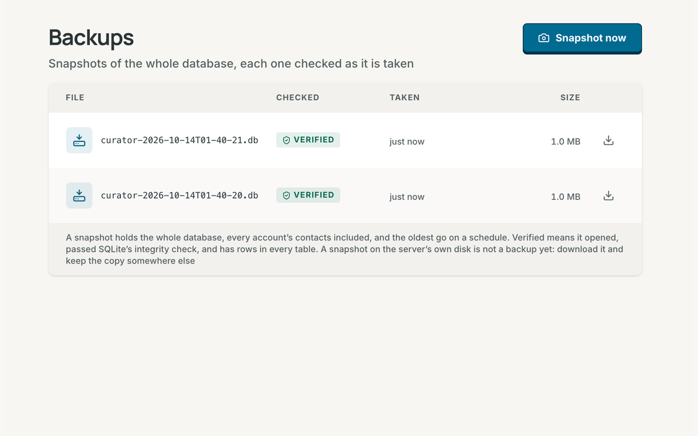
<h3>Verified backups</h3>
Your history is irreplaceable. Take a complete, integrity-checked snapshot of your address book in one click, or let Contrack back itself up automatically on your schedule.
</td>
</tr>
</table>

<table>
<tr>
<td width="50%" valign="top">
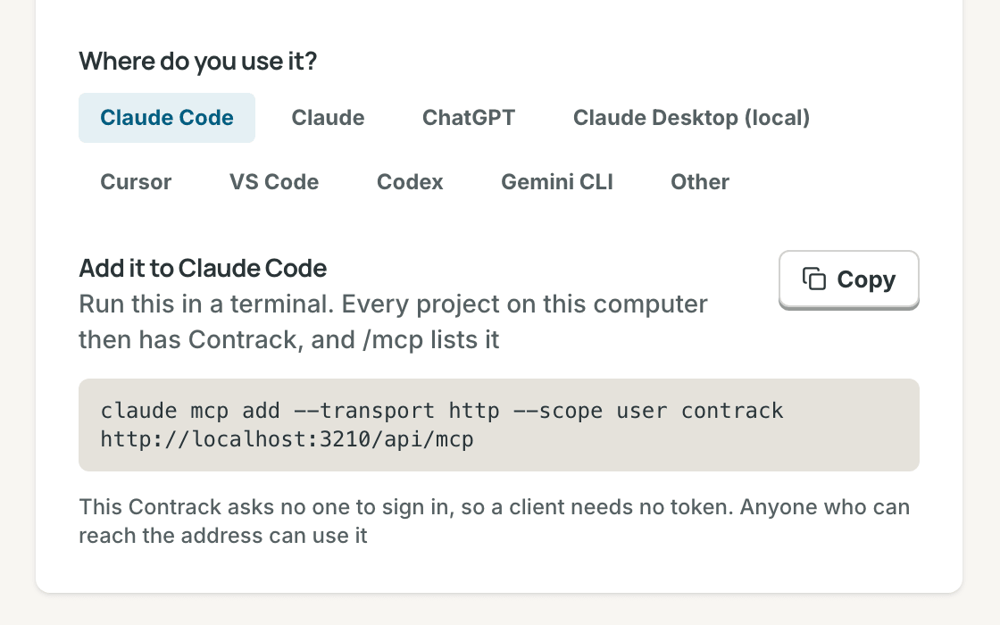
<h3>Works with your AI assistant</h3>
Connect Claude, ChatGPT, or Cursor in one click so your favorite assistant can look up context and log notes for you, with read-only access whenever you prefer.
</td>
<td width="50%" valign="top">
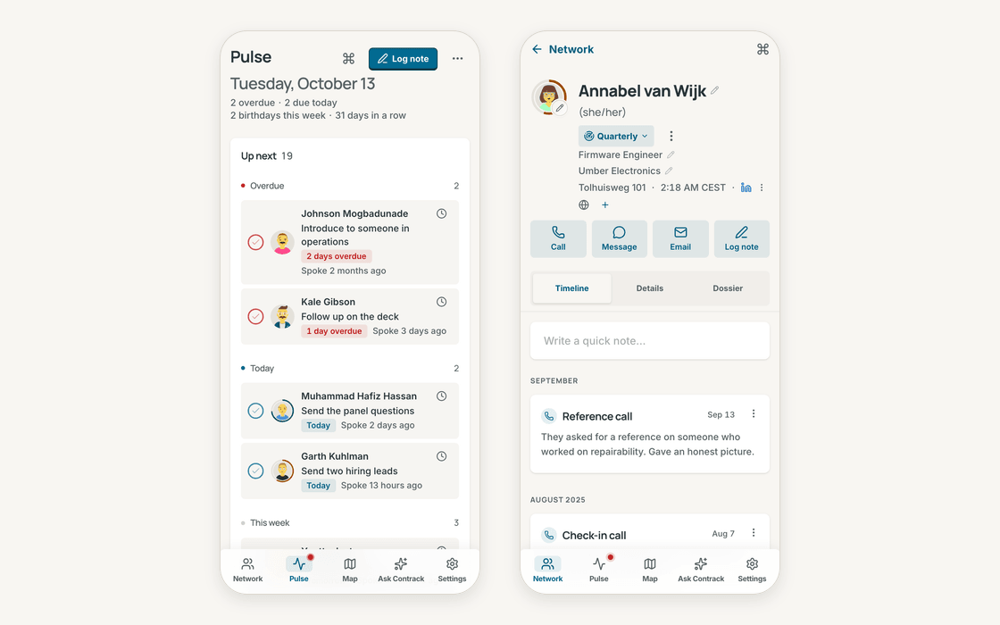
<h3>Right in your pocket</h3>
Add Contrack to your phone's home screen. Before you walk into coffee or a meeting, every note and detail is one tap away.
</td>
</tr>
</table>

**And everything else you expect:** rich notes with file & image attachments, `@mentions` that link people together, custom dates and anniversaries, lists and tags, passkey sign-in, a 90-day trash with undo, open exports anytime, and warm light and dark themes.

## Privacy
**Privacy isn't a setting. It's the foundation.** Contrack lives on your own computer or home server. Your relationships aren't training anyone's model, sitting on a rented cloud, or locked behind a monthly subscription. Search happens right on your device.

Share one home server with your family or team while keeping everyone's address book completely private to them. And when you want AI to research a contact or turn a quick note into a rich profile, you bring the model you trust, or use none at all.


## Comparing personal CRMs?
* [Contrack vs Monica](docs/comparisons/contrack-vs-monica.md)
* [Contrack vs Clay](docs/comparisons/contrack-vs-clay.md)
* [Contrack vs Folk](docs/comparisons/contrack-vs-folk.md)
* [Contrack vs Twenty](docs/comparisons/contrack-vs-twenty.md)
* [Contrack vs Huly](docs/comparisons/contrack-vs-huly.md)
* [Contrack vs EspoCRM](docs/comparisons/contrack-vs-espocrm.md)
* [Contrack vs Nextcloud Contacts](docs/comparisons/contrack-vs-nextcloud-contacts.md).

## Start in a minute

Run Contrack on your machine with Docker:

```bash
docker run -d --name contrack -p 127.0.0.1:3210:3210 \
  -v contrack-data:/app/data ghcr.io/arvarik/contrack:latest
```

Then open [http://localhost:3210](http://localhost:3210). There is no cloud account to sign up for and no API key required. Everything stays in your `contrack-data` folder. Whenever you want AI features, open **Settings → Administration → AI**.

<details>
<summary><b>Other ways to run it</b></summary>

<br/>

**Docker Compose** with the published image:

```yaml
services:
  contrack:
    image: ghcr.io/arvarik/contrack:latest
    container_name: contrack
    restart: unless-stopped
    ports:
      - "127.0.0.1:3210:3210"
    volumes:
      - contrack-data:/app/data
    environment:
      - AUTH_REQUIRED=false # Set to true before exposing beyond localhost

volumes:
  contrack-data:
```

Or build the image from this repository:

```bash
git clone https://github.com/arvarik/contrack.git && cd contrack
docker compose up -d
```

**From source**, with Node.js 26.10 or later:

```bash
git clone https://github.com/arvarik/contrack.git && cd contrack
npm install
npm run dev
```

**For your household or team:** turn on sign-in with `-e AUTH_REQUIRED=true`. Your first visit creates the admin profile, and you can invite family or teammates from **Settings → Administration → Accounts**. See the [Self-hosting guide](docs/self-hosting.md) for remote access, backups, and upgrades.

</details>

## Try it in your browser

[](https://codespaces.new/arvarik/contrack?quickstart=1)

Open a live demo in your browser preloaded with 400 fictional people, with no installation and no API key needed.

<br/>

<!-- prettier-ignore-start -->
<div align="center">
  <div><a href="CONTRIBUTING.md"><picture><source media="(prefers-color-scheme: dark)" srcset="docs/brand/tree/r1-l-dark.svg" /></picture></a><a href="CODE_OF_CONDUCT.md"><picture><source media="(prefers-color-scheme: dark)" srcset="docs/brand/tree/r1-r-dark.svg" /></picture></a></div>
  <div><a href="AGENTS.md"><picture><source media="(prefers-color-scheme: dark)" srcset="docs/brand/tree/r2-l-dark.svg" /></picture></a><a href="CHANGELOG.md"><picture><source media="(prefers-color-scheme: dark)" srcset="docs/brand/tree/r2-r-dark.svg" /></picture></a></div>
  <div><a href="docs/README.md"><picture><source media="(prefers-color-scheme: dark)" srcset="docs/brand/tree/r3-l-dark.svg" /></picture></a><a href="LICENSE"><picture><source media="(prefers-color-scheme: dark)" srcset="docs/brand/tree/r3-r-dark.svg" /></picture></a></div>
  <div><a href="https://github.com/arvarik/contrack/discussions/categories/q-a"><picture><source media="(prefers-color-scheme: dark)" srcset="docs/brand/tree/r4-l-dark.svg" />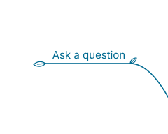</picture></a><picture><source media="(prefers-color-scheme: dark)" srcset="docs/brand/tree/r4-c-dark.svg" /></picture><a href="LICENSE"><picture><source media="(prefers-color-scheme: dark)" srcset="docs/brand/tree/r4-r-dark.svg" />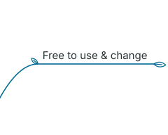</picture></a></div>
  <div><a href="https://github.com/arvarik/contrack/issues/new/choose"><picture><source media="(prefers-color-scheme: dark)" srcset="docs/brand/tree/r5-l-dark.svg" /></picture></a><a href="LICENSE"><picture><source media="(prefers-color-scheme: dark)" srcset="docs/brand/tree/r5-r-dark.svg" /></picture></a></div>
  <div><a href="SECURITY.md"><picture><source media="(prefers-color-scheme: dark)" srcset="docs/brand/tree/r6-dark.svg" /></picture></a></div>
  <div><a href="mailto:arvind.arikatla@gmail.com"><picture><source media="(prefers-color-scheme: dark)" srcset="docs/brand/tree/r7-dark.svg" /></picture></a></div>
</div>
<!-- prettier-ignore-end -->
